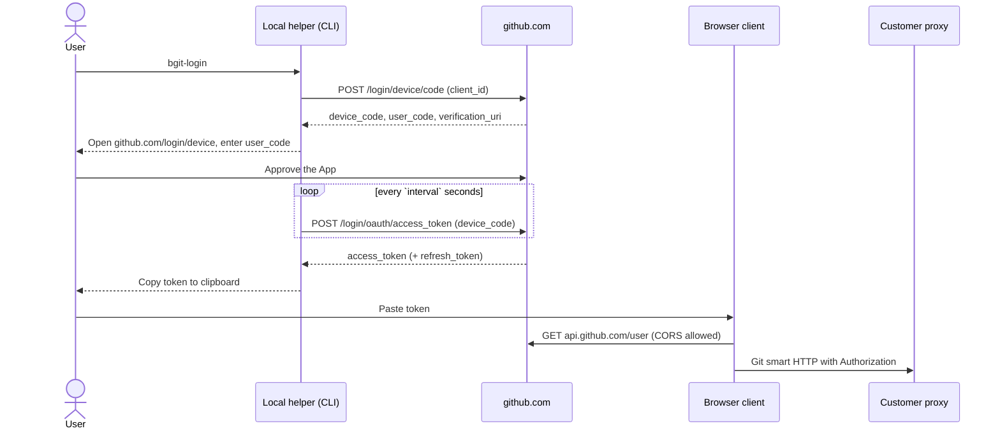

# GitHub repository access options for the browser client

The browser client uses [isomorphic-git](https://isomorphic-git.org/) for Git
smart HTTP. It sends repository credentials as HTTP Basic authentication through
the customer proxy:

```typescript
onAuth: () => ({ username: "x-access-token", password: token })
```

Any token type below works with that callback. The options differ in how the
user obtains the token, how long it lives, and whether the proxy must change.

| Option | Proxy change | Secret required | Token lifetime | Usability |
|---|---|---|---|---|
| 1. Personal access token | None | No | User-chosen, subject to org policy | Manual creation and paste |
| 2. Out-of-browser device flow | None | No | 8 h access, 6 months refresh (or non-expiring) | Run a helper, approve on GitHub, hand off token |
| 3. Proxy-hosted OAuth helper | Generic confidential-client handler | Yes, in the proxy only | 8 h access, 6 months refresh | In-browser sign-in |

## Browser constraints that apply to every option

- GitHub's `github.com/login/device/code` and `github.com/login/oauth/access_token`
  endpoints do not support CORS. A page cannot start device flow, poll for the
  token, or refresh it by itself.
- Git smart HTTP on `github.com` does not support CORS either; it already goes
  through the customer proxy.
- `api.github.com` supports CORS, so the page can validate a token directly with
  `GET https://api.github.com/user` and show who is signed in.
- Persistence is mandatory (see the README). Whatever token the user supplies is
  stored by the browser client; the storage mechanism is still an open question.

## Option 1: Personal access token (PAT)

The simplest option: it works with the currently deployed proxy and needs no
GitHub App registration.

1. The user creates a **fine-grained PAT** at
   <https://github.com/settings/personal-access-tokens/new>:
   - Resource owner: the user or organization that owns the repositories.
   - Repository access: only the repositories the client should open.
   - Permissions: **Contents** read and write (Metadata read is added automatically).
   - Expiration: as short as practical, within the organization's policy.
2. The user pastes the token into the browser client.
3. The client validates it with `GET https://api.github.com/user`, persists it,
   and uses it for clone, fetch, and push.
4. On `401`, the client keeps pending edits and asks for a new token.

Tradeoffs:

- Straightforward to implement; no OAuth code, proxy routes, or App registration.
- Poor usability: users must understand permissions, create, rotate, and paste
  tokens themselves. There is no refresh; expiry means creating a new token.
- Organizations can require approval for fine-grained PATs or restrict their
  lifetime. Classic PATs need SAML SSO authorization for SSO-protected
  organizations and have much broader `repo` scope; prefer fine-grained PATs.
- The token is tied to the user, not to the application, so the organization
  cannot tell application access from other PAT use.

## Option 2: Out-of-browser device flow

Device flow needs only a public client ID, but its endpoints are not reachable
from the page. Running the flow in a small local helper avoids proxy changes and
still produces an application-scoped GitHub App user token.

### Setup (once per customer)

1. An administrator registers a GitHub App with **Enable Device Flow** checked,
   no callback URL, no webhook, and repository permissions **Contents: read and
   write** (Metadata read is implied).
2. The administrator installs the App on the organization or selected
   repositories. Users can only access repositories where both the installation
   and the user's own permissions allow it.
3. The App's **client ID** (not a secret) is configured in the helper and the
   browser client.

### Sign-in sequence



The helper can be a short PowerShell, Python, Node.js, or shell script; it needs
only HTTPS access to `github.com` and the public client ID. A minimal shell
version:

```sh
CLIENT_ID=Iv1.xxxxxxxx
resp=$(curl -s -X POST https://github.com/login/device/code \
  -H 'Accept: application/json' -d "client_id=$CLIENT_ID")
echo "Open $(jq -r .verification_uri <<<"$resp") and enter $(jq -r .user_code <<<"$resp")"
device_code=$(jq -r .device_code <<<"$resp"); interval=$(jq -r .interval <<<"$resp")
while sleep "$interval"; do
  tok=$(curl -s -X POST https://github.com/login/oauth/access_token \
    -H 'Accept: application/json' \
    -d "client_id=$CLIENT_ID&device_code=$device_code&grant_type=urn:ietf:params:oauth:grant-type:device_code")
  case $(jq -r '.error // empty' <<<"$tok") in
    authorization_pending) ;;
    slow_down) interval=$((interval + 5)) ;;
    "") jq -r .access_token <<<"$tok"; break ;;
    *) echo "$tok" >&2; exit 1 ;;
  esac
done
```

### Handing the token to the browser

- **Paste (recommended):** the helper copies the token to the clipboard; the user
  pastes it into the client. Nothing appears in URLs or browser history.
- **URL fragment:** the helper opens `http://localhost:5130/#token=...`. The
  fragment is not sent to servers, but it can remain in history unless the page
  removes it immediately with `history.replaceState`. Avoid query strings.
- A local loopback listener in the helper would require the page to call
  `localhost` with CORS and adds attack surface; it is not recommended.

### Expiry and refresh

GitHub App user tokens expire after **8 hours** by default, with a **6-month**
refresh token. Refreshing a device-flow token does not require the client secret,
but it still calls `github.com/login/oauth/access_token`, which the page cannot
reach. Choices:

1. **The helper keeps the refresh token** (for example, in the OS keychain) and
   reissues an access token on demand. The browser asks the user to rerun the
   helper about once per working day.
2. **Opt out of expiring user tokens** in the App's optional features. Tokens then
   behave like PATs (long-lived, no refresh) but remain App-scoped, revocable per
   App, and visible to organization administrators.
3. **Paste both tokens** and refresh from the browser through a proxy route. This
   needs a proxy change; see option 3.

### Variant: GitHub CLI token

For research and development only, `gh auth token` prints the GitHub CLI's
existing OAuth token. It works immediately with no App registration, but it is
the CLI's credential with broad `repo` scope, and revoking it signs out the CLI.
It is not suitable for production.

### Tradeoffs

- No proxy change and no secret anywhere; tokens are App-scoped and auditable.
- The organization controls access through App installation and permissions.
- Users must install or run a helper outside the browser, which weakens the
  browser-only experience and may be blocked on managed devices.
- Refresh is not automatic unless tokens are non-expiring or the proxy changes.

## Option 3: Proxy-hosted OAuth helper (confidential client)

If the proxy is extended, it should be with a **generic OAuth confidential-client
helper** rather than ad hoc routes for individual GitHub endpoints. The helper:

- Holds the App's client secret in the deployment's secret store and injects it
  into fixed token-endpoint requests (authorization-code exchange with PKCE and
  refresh-token exchange).
- Is configured per provider (token endpoint URL, client ID, callback URL), so the
  same component can serve GitHub, GitLab, or other OAuth providers.
- Remains stateless: it returns tokens to the browser, which persists them, and
  never stores, logs, or caches them.

This enables standard browser-redirect sign-in and automatic refresh entirely in
the browser. This option is implemented: see
[`proxy/oauth_helper.py`](../proxy/oauth_helper.py) and the
[OAuth token helper](azure-git-proxy.md#oauth-token-helper) guide.

## References

- [Generating a user access token for a GitHub App (device flow)](https://docs.github.com/en/apps/creating-github-apps/authenticating-with-a-github-app/generating-a-user-access-token-for-a-github-app#using-the-device-flow-to-generate-a-user-access-token)
- [Refreshing user access tokens](https://docs.github.com/en/apps/creating-github-apps/authenticating-with-a-github-app/refreshing-user-access-tokens)
- [Managing personal access tokens](https://docs.github.com/en/authentication/keeping-your-account-and-data-secure/managing-your-personal-access-tokens)
