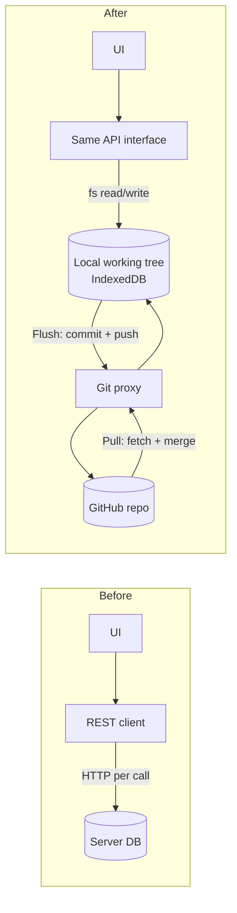

# Migrating a CRUD REST client to Git storage

This guide shows how to replace a plain CRUD REST API with Git-backed storage
in the browser. Books are only the demo entity: a real app has many resources,
and each one becomes a folder handled by the generic `GitCollection<T>`
([`src/collection.ts`](../src/collection.ts); books are wrapped in
[`src/books.ts`](../src/books.ts), sync is in [`src/git.ts`](../src/git.ts)). Calls that
previously went to a server now read and write a local Git working tree in the
browser. The app syncs with the remote repository explicitly: **Pull** fetches
changes and **Flush** commits local changes and pushes them.

It assumes every resource is plain CRUD: create, read, update, delete, and
list, keyed by ID, with no server-side queries, joins, or business logic.

## 1. Before and after



The UI keeps calling the same interface. Only the implementation behind it
changes, and network access moves to two explicit operations, Pull and Flush.

## 2. Extract the API interface

Put a TypeScript interface between the UI and the existing REST client, if
there isn't one already. Plain CRUD resources share one generic contract,
`CrudApi<T>` in `src/collection.ts`:

| REST endpoint | `CrudApi<T>` method | Git storage implementation |
| --- | --- | --- |
| `GET /{collection}` | `list()` | `readdir("{collection}/")`, decode file names to IDs |
| `GET /{collection}/{id}` | `read(id)` | `readFile`, decode; `null` if missing (was 404) |
| `POST /{collection}` / `PUT /{collection}/{id}` | `write(id, value)` | encode, `writeFile` |
| `DELETE /{collection}/{id}` | `delete(id)` | `unlink`; `false` if missing |

Create one collection per resource, for example:

```ts
const books = new GitCollection(dir, "books", textCodec(".md"));
const authors = new GitCollection<Author>(dir, "authors", jsonCodec<Author>());
const orders = new GitCollection<Order>(dir, "orders", jsonCodec<Order>());
```

All collections live in the same working tree, so one Flush commits and pushes
changes across every entity in a single commit, and one Pull updates them all.

If the existing UI uses entity-specific method names, keep them with a thin
wrapper, as the demo does for books:

| REST endpoint | Interface method | Git storage implementation |
| --- | --- | --- |
| `GET /books` | `listBooks()` | `readdir("books/")`, decode file names to IDs |
| `GET /books/{id}` | `readBook(id)` | `readFile("books/{id}.md")`; `null` if missing (was 404) |
| `POST /books` / `PUT /books/{id}` | `writeBook(id, content)` | `writeFile("books/{id}.md")` |
| `DELETE /books/{id}` | `deleteBook(id)` | `unlink("books/{id}.md")` |

```ts
export interface BookApi {
  listBooks(): Promise<string[]>;
  readBook(id: string): Promise<string | null>;
  writeBook(id: string, content: string): Promise<void>;
  deleteBook(id: string): Promise<boolean>;
}
```

Keep the existing `RestBookApi implements BookApi` during migration, so you can
switch implementations with a flag and compare their behaviour.

## 3. Map resources to files

Use one file per resource: `{collection}/{id}.{ext}`.

- **Collection → folder.** Each resource type gets its own top-level folder,
  such as `books/` or `authors/`.
- **ID → file name.** Percent-encode the ID (`encodeURIComponent`, plus `*`) so
  that any string becomes one portable file name. This prevents `/` from
  creating subfolders and avoids characters invalid on Windows. See
  `GitCollection.path()`.
- **Body → file content.**
  - Use the format the payload already has: `.json` for JSON DTOs
    (`jsonCodec`), `.md` for documents (`textCodec(".md")`). Write a custom
    `Codec<T>` for other formats.
  - Serialise deterministically (stable key order, 2-space indent, trailing
    newline). Git diffs and merges then work line by line.
  - Avoid one large file per collection: every write would conflict.
- **Server-generated IDs.** For `POST` without an ID, generate the ID on the
  client (`crypto.randomUUID()`), because there is no server to assign one.
- **Server-maintained fields** such as `createdAt`, `updatedAt` and `etag` come
  from Git history (`git.log({ filepath })`). Alternatively, write them into the
  file on the client.

## 4. Implement the storage class

Reuse the demo's pieces:

- `fs`: the LightningFS instance in `src/git.ts`, shared with isomorphic-git.
- `exists` and `mkdirp`: helpers in `src/git.ts`.
- `GitCollection<T>` and the codecs in `src/collection.ts`: complete list,
  read, write and delete for any entity type.
- `BookStore` in `src/books.ts`: an entity-specific wrapper over it.

Rules for the implementation:

1. **No network calls.** Every method must work offline once the repository has
   been pulled. If there is no local clone yet, throw an error asking the user
   to pull (see `localRepository()` in `src/main.ts`).
2. **Persist before resolving.** After writing, call `await fs.promises.flush()`
   so the change is saved in IndexedDB before the promise resolves. A reload or
   crash then cannot lose it.
3. **Delete** is `fs.promises.unlink(path)`. Flush picks it up as a `deleted`
   change and runs `git.remove`.
4. **Keep the method signatures and error shapes the UI already expects.** For
   example, return `null` for "not found" rather than throwing, if the UI
   handled a 404 that way.

## 5. Add sync operations

Expose these alongside the API (from `src/git.ts`):

| Operation | Function | When to call |
| --- | --- | --- |
| Pull | `cloneOrPull(url)` | First use (clone), and on user request or at app start when online. Refuse if there are unflushed changes; flush first. |
| Pending changes | `pendingChanges(dir)` | Show "unsaved to server" state, and block Pull when non-empty. |
| Flush | `flush(dir, author)` | Stages all changes, makes one commit, pushes to `main`. If the push is rejected, it pulls and merges once, then retries. |

Today Flush is triggered by a button. To flush automatically, call it
debounced after writes (for example 10–30 seconds) and when the page is hidden
(`visibilitychange`).
- Serialise flushes across tabs with `navigator.locks.request("bgit-flush", …)`.
- Back off on network or auth errors.
- Never discard local commits.

## 6. Authentication and transport

- Sign-in uses the OAuth helper (see
  [`azure-git-proxy.md`](azure-git-proxy.md#oauth-token-helper)). The token is
  used for Git HTTP only; book reads and writes never need it.
- When signed in, Git requests send the token up front (`remoteOptions()` in
  `src/git.ts`). This avoids an extra unauthenticated request that would
  otherwise fail with 401 on every Pull or Flush.
- Access control is per repository. Anything that used to need per-record
  authorisation must be split into separate repositories, or kept on the server.

## 7. Behaviour changes to communicate

| Concern | REST | Git storage |
| --- | --- | --- |
| Durability | Durable after the request succeeds | Locally durable after write; on the server after Flush |
| Offline | Fails | Reads and writes work; sync waits |
| Concurrency | Last write wins, or ETag/409 | Conflicts surface at Flush; a non-conflicting merge succeeds automatically |
| Validation | Server-side | Client-side only; add CI checks on the repository if required |
| Queries | Server filters and pagination | Client-side over local files; fine for hundreds to low thousands of files |
| History / audit | Usually none | Full Git history per file |
| Storage limits | Server | Browser quota; data may be evicted unless `navigator.storage.persist()` is granted |

## 8. Migration checklist

1. Extract the API interface and switch the UI to depend on it.
2. Choose the file layout per collection and the serialisation rules.
3. Export the existing server data into that layout and commit it to the
   repository once.
4. Implement the Git storage class: list, read, write and delete, local only.
5. Add Pull, pending-changes indicator and Flush to the UI.
6. Switch the implementation behind a flag, then verify:
   - CRUD works offline;
   - data survives a browser restart;
   - Flush appears as a commit on `main`;
   - a concurrent remote edit merges or reports a conflict.
7. Remove the REST client once both implementations behave the same.

## Known limitations

- **Merge conflicts are not resolved yet.** Flush stops and keeps the local
  commit; resolution UI is future work.
- **Not suited to large or binary data.** isomorphic-git has no Git LFS support,
  and pack data is processed in memory.
- **No secrets in the repository.** The repository is readable by everyone
  with access to it.
